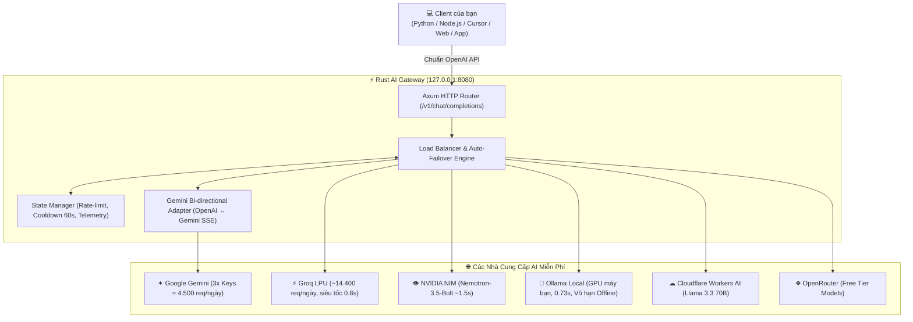

# 🚀 AI Gateway (Rust) · Cổng Tích Hợp Đa Nguồn AI Miễn Phí 100%

<p align="center">
  
  
  
  
  
</p>

> **Dự án mã nguồn mở dành riêng cho các bạn học sinh, sinh viên và lập trình viên:** Giúp bạn thỏa sức làm đồ án, xây dựng Chatbot, phát triển AI Agent hoặc tích hợp vào IDE (Cursor, Roo Code, Cline, OpenCode) mà **hoàn toàn không tốn tiền mua API** và **không cần thẻ ngân hàng quốc tế (Visa/Mastercard)**!

---

## 💡 Tại sao dự án này ra đời?

Khi học tập và làm các dự án AI/LLM, rào cản lớn nhất của học sinh - sinh viên thường là:
1. **Chi phí đắt đỏ:** API của OpenAI/Anthropic tính phí theo token hoặc yêu cầu gói trả phí 20$/tháng.
2. **Yêu cầu thẻ tín dụng:** Nhiều nhà cung cấp đám mây bắt buộc phải liên kết thẻ Visa/Mastercard mới cho dùng thử.
3. **Bị giới hạn tốc độ (Rate Limit):** Các gói miễn phí (Free Tier) thường bị giới hạn lượt gọi (15 RPM hoặc 1.500 RPD), đang test đồ án thì bị lỗi `429 Too Many Requests`.

🎯 **Giải pháp:** **AI Gateway** viết bằng ngôn ngữ **Rust** siêu nhẹ, đóng vai trò làm trung gian (Reverse Proxy). Bạn chỉ cần cắm các API Key miễn phí (Google Gemini, Groq, NVIDIA NIM, Cloudflare, OpenRouter, Ollama Local) vào Gateway. Gateway sẽ:
* **Gộp toàn bộ hạn mức:** Tự động đạt hơn **22.000+ requests/ngày** miễn phí.
* **Xoay tua thông minh (Load Balancing & Auto-Failover):** Key nào bị rate-limit hoặc lỗi mạng sẽ tự động cho "nghỉ ngơi" (Cooldown 60s) và chuyển ngay sang key khác trong `<1ms` mà không làm gián đoạn ứng dụng của bạn.
* **Chuẩn hóa OpenAI 100%:** Cung cấp duy nhất một endpoint chuẩn `/v1/chat/completions` (hỗ trợ cả Streaming SSE thời gian thực). Bạn chỉ cần trỏ thư viện OpenAI SDK sang `http://127.0.0.1:8080/v1` là xong!

---

## 🏗 Kiến Trúc Hoạt Động (Architecture)



---

## ✨ Tính Năng Nổi Bật

* 🚀 **Hiệu năng cực đỉnh với Rust:** Khởi động tức thì, tiêu thụ chỉ **~10MB RAM**, độ trễ định tuyến dưới 1 mili-giây.
* 🔄 **Chiến lược xoay tua linh hoạt:** Hỗ trợ `sequential` (ưu tiên theo thứ tự), `round_robin` (chia đều tải), hoặc `random` (ngẫu nhiên).
* 🛡 **Cơ chế Cooldown thông minh:** Tự động phát hiện lỗi `429 (Rate Limit)`, `5xx (Máy chủ quá tải)` hoặc ngắt mạng để đưa account vào danh sách chờ và tự kích hoạt lại khi hết thời gian phạt.
* 🔌 **Tương thích 100% với OpenAI SDK:** Chạy được với thư viện chính thức của OpenAI trên Python, Node.js, Go, cURL, LangChain, LlamaIndex, v.v.
* 🖥 **Giao diện Web Console (Playground & Settings):**
  * Giao diện Dark Theme hiện đại phong cách **Software** lấy cảm hứng từ Figma và x.ai.
  * Tích hợp Playground Chat trực tiếp kiểm tra model.
  * Theo dõi bảng số liệu Telemetry (lượt gọi, tỉ lệ thành công, trạng thái cooldown) theo thời gian thực.
  * Thêm/sửa API Key và reload cấu hình trực tiếp trên Web UI mà không cần khởi động lại Gateway.
* 🦙 **Hỗ trợ chạy Offline với Ollama:** Tự động kết nối với Ollama nội bộ trên máy, cho phép bạn lập trình cả khi mất mạng Internet!

---

## 🛠 Hướng Dẫn Cài Đặt & Chạy (Quickstart)

### Yêu cầu tiên quyết
* Đã cài đặt [Rust Toolchain](https://rustup.rs/) (nếu biên dịch từ mã nguồn).
* Hoặc máy tính chạy Windows/Linux/macOS.

### Bước 1: Clone dự án về máy
```bash
git clone https://github.com/gray8493/ai_api_free.git
cd ai_api_free
```

### Bước 2: Chuẩn bị file cấu hình & Chạy Gateway
```bash
# Tạo file cấu hình từ file mẫu nếu chạy lần đầu
cp config.example.json config.json
```

#### Cách 1: Chạy nhanh bằng script (Khuyên dùng trên Windows)
```powershell
.\run.ps1
```
*(Script sẽ tự kiểm tra môi trường, biên dịch bản tối ưu `--release` và khởi chạy trên cổng `8080`).*

#### Cách 2: Chạy trực tiếp bằng Cargo
```bash
cargo run --release
```

### Bước 3: Mở Web Console
Truy cập trình duyệt tại: **[http://127.0.0.1:8080/](http://127.0.0.1:8080/)**

---

## 🔑 Hướng Dẫn Lấy API Key Miễn Phí (100% Không Cần Thẻ)

Bạn chỉ cần dành khoảng 5 phút để lấy key miễn phí từ các nhà cung cấp sau:

| STT | Nhà Cung Cấp | Trang Đăng Ký (Free) | Hạn Mức Miễn Phí | Điểm Nổi Bật |
| :---: | :--- | :--- | :--- | :--- |
| **1** | **Google Gemini** | [aistudio.google.com](https://aistudio.google.com/apikey) | 1.500 req/ngày / 1 tài khoản | Ngữ cảnh 1M tokens, tiếng Việt siêu chuẩn |
| **2** | **Groq** | [console.groq.com](https://console.groq.com/keys) | ~14.400 req/ngày (30 RPM) | Siêu tốc độ với chip LPU (~0.8s) |
| **3** | **NVIDIA NIM** | [build.nvidia.com](https://build.nvidia.com/) | 1.000 credits dùng thử | Model doanh nghiệp Nemotron-3.5-Bolt |
| **4** | **Cloudflare AI** | [dash.cloudflare.com](https://dash.cloudflare.com/) | 10.000 Neurons/ngày | Llama-3.3-70B mạng phân tán toàn cầu |
| **5** | **OpenRouter** | [openrouter.ai](https://openrouter.ai/keys) | ~200 - 400 req/ngày | Chọn model có đuôi `:free` |
| **6** | **Ollama (Local)** | [ollama.com](https://ollama.com/) | **VÔ HẠN (Offline)** | Chạy trên GPU máy bạn, 0đ, không cần mạng |

> 💡 **Mẹo cho học sinh, sinh viên:** Bạn có thể dùng 2 - 3 tài khoản Gmail khác nhau để tạo 2 - 3 API Key Google Gemini, sau đó dán vào Gateway để có ngay **4.500 requests/ngày** miễn phí mà không bao giờ lo hết hạn mức!

---

## 💻 Hướng Dẫn Sử Dụng Code Mẫu

Sau khi Gateway đã chạy tại `http://127.0.0.1:8080`, bạn có thể dùng trong mọi dự án:

### 1. Python (OpenAI SDK chính thức)
```bash
pip install openai
```
```python
from openai import OpenAI

# Trỏ baseURL về Gateway nội bộ của bạn
client = OpenAI(
    base_url="http://127.0.0.1:8080/v1",
    api_key="khong-can-thiet" # Gateway không bắt buộc key
)

# Chế độ 'auto': Gateway tự động chọn provider khả dụng và xoay tua
response = client.chat.completions.create(
    model="auto",
    messages=[
        {"role": "system", "content": "Bạn là trợ lý AI hữu ích."},
        {"role": "user", "content": "Giải thích định lý Pytago ngắn gọn bằng tiếng Việt."}
    ],
    temperature=0.7,
)

print(response.choices[0].message.content)
```

### 2. Node.js / JavaScript (OpenAI SDK)
```bash
npm install openai
```
```javascript
import OpenAI from "openai";

const client = new OpenAI({
  baseURL: "http://127.0.0.1:8080/v1",
  apiKey: "dummy-key",
});

async function run() {
  const stream = await client.chat.completions.create({
    model: "auto",
    messages: [{ role: "user", content: "Viết hàm tính giai thừa trong JS" }],
    stream: true,
  });

  for await (const chunk of stream) {
    process.stdout.write(chunk.choices[0]?.delta?.content || "");
  }
}

run();
```

### 3. Gọi trực tiếp bằng cURL
```bash
curl http://127.0.0.1:8080/v1/chat/completions \
  -H "Content-Type: application/json" \
  -d '{
    "model": "auto",
    "messages": [{"role": "user", "content": "Xin chào Gateway!"}]
  }'
```

### 4. Chỉ định đích danh một Provider
Nếu muốn gọi đích danh một model cụ thể của một hãng, bạn dùng cú pháp: `<provider_id>/<model_name>`:
* Gọi Groq: `"model": "groq/qwen/qwen3.8-27b"`
* Gọi Gemini: `"model": "gemini/gemini-3.1-flash-lite"`
* Gọi NVIDIA: `"model": "nvidia/nvidia/nemotron-3.5-bolt-e4b"`
* Gọi Ollama Offline: `"model": "ollama/gemma4-fast:latest"`

---

## 🤖 Kết Nối Vào Các Công Cụ Lập Trình (Cursor / Roo Code / Cline)

Bạn có thể dùng Gateway này để lập trình miễn phí trong các công cụ AI Extension của VS Code:

* **Trong Roo Code / Cline:**
  * **Provider:** Chọn `OpenAI Compatible`.
  * **Base URL:** Điền `http://127.0.0.1:8080/v1`.
  * **API Key:** Điền ký tự bất kỳ (ví dụ: `sk-free-gateway`).
  * **Model ID:** Điền `auto` hoặc `groq/qwen/qwen3.8-27b`.
* **Trong Cursor IDE:**
  * Vào `Settings` -> `Models` -> Thêm OpenAI API Base: `http://127.0.0.1:8080/v1`.

---

## 📂 Cấu Trúc Mã Nguồn (Dành cho các bạn muốn học Rust)

Dự án được viết rất trực quan, sạch sẽ và chuẩn phong cách Rust idiomatic:

```
ai_api_free/
├── src/
│   ├── main.rs      # Điểm khởi đầu, lắng nghe cổng mạng, định tuyến Axum
│   ├── config.rs    # Đọc/ghi và xác thực file cấu hình config.json
│   ├── state.rs     # Quản lý bộ nhớ chia sẻ (Arc<AppState>), Telemetry & Cooldown
│   ├── proxy.rs     # Thuật toán xoay tua, chuyển tiếp Request/Stream, cơ chế Retry
│   ├── gemini.rs    # Bộ chuyển đổi 2 chiều chuẩn OpenAI ↔ Google Gemini JSON/SSE
│   ├── api.rs       # Các REST API điều khiển và phục vụ trang giao diện HTML
│   └── ui.html      # Giao diện Web Console (Single Page Application, không cần build)
├── config.example.json # Mẫu cấu hình chuẩn (an toàn, không chứa key cá nhân)
├── config.json         # Cấu hình chứa API Key thật của bạn (đã được .gitignore bảo vệ 100%)
├── Cargo.toml          # Quản lý dependencies (Tokio, Axum, Reqwest, Serde)
└── run.ps1          # Script khởi động tự động cho Windows
```

---

## ☕ Ủng Hộ Tác Giả (Buy Me a Coffee)

Dự án được phát triển và chia sẻ hoàn toàn **miễn phí phi lợi nhuận** nhằm hỗ trợ cộng đồng học sinh, sinh viên và các lập trình viên trẻ tiếp cận công nghệ AI dễ dàng hơn.

Nếu dự án này giúp bạn tiết kiệm được tiền mua API, hoàn thành tốt bài tập lớn, đồ án tốt nghiệp hay công việc lập trình, bạn có thể gửi tặng tác giả một ly cà phê để tiếp thêm động lực phát triển nhé! ❤️

<div align="center">


<br/>

**Ngân hàng:** MB Bank (Ngân hàng TMCP Quân Đội)  
**Số tài khoản:** `0837474615`  
**Chủ tài khoản:** THI TDA  
**Nội dung:** `Ung ho AI Gateway`

</div>

---

## 📜 Giấy Phép (License)

Dự án phát hành theo giấy phép **MIT License**. Bạn được tự do sao chép, chỉnh sửa, tích hợp vào đồ án cá nhân hoặc thương mại.

⭐ Đừng quên bấm **Star** ủng hộ kho lưu trữ nếu bạn thấy dự án hữu ích nhé! Chúc các bạn học tập tốt và tạo ra nhiều sản phẩm AI tuyệt vời! 🚀
